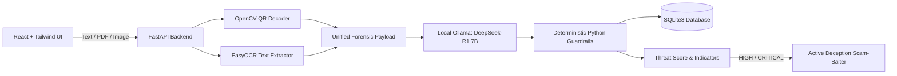

# 🛡️ SecureX AI

**Next-Generation Phishing & Quishing Detection Engine with Hybrid Heuristic-LLM Architecture and Active Cyber Deception**

[](https://www.python.org/)
[](https://fastapi.tiangolo.com/)
[](https://react.dev/)
[](https://tailwindcss.com/)
[](https://ollama.com/)
[](https://www.docker.com/)

---

## 📌 Overview

**SecureX AI** is a privacy-first, air-gapped cybersecurity triage platform designed to detect modern social engineering attacks—including **AI-generated spear-phishing** and **Quishing (QR Code Phishing)**—without sending sensitive institutional or enterprise data to third-party cloud APIs.

Unlike traditional text-only spam filters or standalone probabilistic LLMs that suffer from hallucinations, SecureX AI combines **Computer Vision (OpenCV + EasyOCR)**, **Local Reasoning (DeepSeek-R1 7B via Ollama)**, and **Deterministic Python Guardrails** to guarantee repeatable, high-accuracy threat classification. When a severe threat is confirmed, analysts can trigger the **Active Cyber Deception (Scam-Baiter)** module to generate safe, time-wasting counter-replies.

---

## ✨ Key Features

- **🔍 Multimodal Threat Ingestion:** Analyze raw text, suspicious URLs, email bodies, images (`PNG`, `JPG`), and `PDF` documents from a unified SOC dashboard.
- **📷 Computer Vision & Quishing Defense:** Uses **OpenCV** to locate and decode hidden QR codes inside images/PDFs while **EasyOCR** extracts embedded text layers simultaneously.
- **🧠 Hybrid Heuristic-LLM Engine:** Pairs local **DeepSeek-R1 (7B)** semantic reasoning with strict, deterministic Python override rules to eliminate false negatives and LLM hallucinations.
- **🎯 Active Cyber Deception (Scam-Baiter):** Automatically surfaces a counter-measure generator for `HIGH` and `CRITICAL` threats, drafting believable, naive, time-wasting responses for analysts without auto-sending or leaking user data.
- **📊 Enterprise SOC Dashboard:** Minimalist dark/light mode React interface featuring real-time Threat Distribution analytics, Scan Activity Timeline, SQLite-backed Scan History logs, and downloadable forensic reports.
- **🔒 100% On-Premise & Air-Gapped:** All OCR, QR decoding, LLM inference, and database storage execute locally via Docker and Ollama.

---

## 🏗️ System Architecture



### Hybrid Scoring Logic
To eliminate non-deterministic LLM variance on critical Indicators of Compromise (IoCs) such as suspicious TLDs (`.xyz`, `.cc`, `.top`), fake billing lures, or hidden QR payloads, the backend enforces a deterministic severity floor:

$$\text{Severity}_{\text{Final}} = \max\left(\text{Score}_{\text{LLM}},\; \text{Score}_{\text{Heuristic}}\right)$$

---

## 📸 Screenshots

> *Tip: Drag and drop your dashboard screenshots directly into GitHub's README editor to replace the placeholders below.*

### Main Dashboard & Threat Analytics


### Active Threat Analysis & Scam-Baiter Module


---

## 🛠️ Tech Stack

| Layer | Technologies |
| :--- | :--- |
| **Frontend** | React 18, Vite, Tailwind CSS, Inter & JetBrains Mono |
| **Backend API** | Python 3.10+, FastAPI, Uvicorn, Pydantic |
| **Computer Vision** | OpenCV (`cv2`), EasyOCR, PyTorch, PyMuPDF (`fitz`) |
| **Local AI Engine** | Ollama, DeepSeek-R1 (`deepseek-r1:7b` quantized) |
| **Database** | SQLite3, SQLAlchemy ORM |
| **Deployment** | Docker, Docker Compose |

---

## 🚀 Getting Started

### Prerequisites
- **Hardware:** Multi-core CPU (Intel i5/i7 or Ryzen 5/7), **16 GB RAM** recommended, 20 GB free SSD space.
- **Software:** [Docker Desktop](https://www.docker.com/products/docker-desktop/), [Ollama](https://ollama.com/), [Node.js 18+](https://nodejs.org/), and Python 3.10+.

### 1. Clone the Repository
```bash
git clone https://github.com/udityam/SecureX-AI.git
cd SecureX-AI
```

### 2. Pull the Local AI Model
Ensure Ollama is running, then pull the quantized DeepSeek-R1 7B model:
```bash
ollama pull deepseek-r1:7b
```

### 3. Start the Backend (Docker or Local)
**Option A: Using Docker Compose**
```bash
docker-compose up --build
```

**Option B: Running Locally**
```bash
cd backend
pip install -r requirements.txt
uvicorn server:app --host 0.0.0.0 --port 8000 --reload
```
The FastAPI interactive documentation will be available at `http://localhost:8000/docs`.

### 4. Start the Frontend
```bash
cd frontend
npm install
npm run dev
```
Open the URL shown in your terminal (typically `http://localhost:5173` or `http://localhost:5174`).

---

## 🔌 Core API Endpoints

| Method | Endpoint | Description |
| :--- | :--- | :--- |
| `POST` | `/api/analyze` | Analyzes raw text/URLs via DeepSeek-R1 and Python guardrails. |
| `POST` | `/api/analyze-file` | Extracts text (EasyOCR) & QR codes (OpenCV) from PDF/PNG/JPG and runs hybrid analysis. |
| `POST` | `/api/generate-bait` | Generates a safe, time-wasting Scam-Baiter counter-payload for verified severe threats. |
| `GET` | `/api/history` | Retrieves persisted scan logs and analytics telemetry from SQLite. |

---

## 🧪 Verification & Testing

SecureX AI has been validated across a 20-point test suite covering:
- **False Positive Checks:** Benign emails, contact snippets, and clean campus notices (`LOW` score, deception module hidden).
- **Guardrail Enforcement:** Fake subscription invoices and suspicious TLDs (`.xyz`, `.cc`) consistently locked to `HIGH`/`CRITICAL` across repeated runs.
- **Quishing Detection:** Embedded QR codes inside PNG invoices and PDF attachments decoded via OpenCV and escalated to `CRITICAL`.
- **Persistence & CORS:** Verified SQLite retention across hard refreshes and clean `OPTIONS`/`POST` preflight handling.

---

## ⚠️ Limitations & Ethical Disclaimer

- **Hardware Latency:** Local 7B inference on CPU-only machines may introduce minor token generation latency compared to GPU-accelerated nodes.
- **Offline Boundary:** By design, the air-gapped engine does not actively crawl live multi-hop URL redirects.
- **Responsible Use:** The Active Cyber Deception (Scam-Baiter) module is strictly a draft-generation utility for authorized security analysts and academic research. It never auto-transmits emails or exposes real user credentials.

---

## 👤 Author

**Uditya Kumar Maddheshiya**  
BCA Final Year — Artificial Intelligence & Cyber Security  
Department of Computer Science & Information Systems  
Shri Ramswaroop Memorial University  

- GitHub: [@udityam](https://github.com/udityam)
